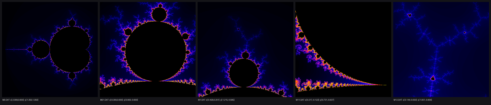

# KI-Mandelbrot

Richard hat 1990/91 in Turbo Pascal Programme geschrieben, die Bilder der
Mandelbrot-Menge berechnen, einfärben und anzeigen. Dieses Projekt bewahrt die
Originale und baut daraus Schritt für Schritt einen modernen Generator für
Bilder und Zoom-Videos. Was in welcher Reihenfolge entsteht, steht im
[Stufenkonzept](specs/stufenkonzept.md).

Das Bild zeigt die fünf Datensätze aus `Org_Daten`, gerendert mit einer
Nachbildung von Palette 1 aus `MANDPAL.PAS`.

## Die Pipeline von 1991

Drei Programme laufen nacheinander. Rechnen und Einfärben sind getrennt, damit
man Farben ändern kann, ohne neu zu rechnen.

| Schritt | Datei | Aufgabe | Ausgabe |
| --- | --- | --- | --- |
| 1. Rechnen | `MANDELDA.PAS` | Fragt xmin, xmax, ymin, ymax ab und iteriert z² + c auf 480 × 480 Punkten mit höchstens 1005 Iterationen. | `mandelN.dat` (Abbruchwerte) |
| 2. Statistik | `MANDELST.PAS` | Zählt, wie oft jeder Abbruchwert vorkommt, und fasst die Werte so zu Farbstufen zusammen, dass jede Stufe etwa gleich viele Punkte bekommt. | `mN.dat` (Farbstufen) |
| 3. Anzeigen | `MANDELFA.PAS` mit `MANDPAL.PAS` | Zeigt `mN.dat` in 640 × 480 mit 256 Farben und einer von vier Paletten. | Bildschirm |

## Die übrigen Dateien

- `MANDELMO.PAS` (1990): ein älteres Experiment mit einer eigenen Formel,
  16 Farben und direkter Ausgabe auf den Bildschirm. Die Bildgrenzen stehen
  fest im Programm.
- `MANDMAUS.PAS`: ein Fragment auf Basis eines Dateimanagers aus den
  Turbo-Pascal-5.5-Beispielen, gedacht als Grundlage für die Auswahl eines
  neuen Ausschnitts mit der Maus. Es lässt sich allein nicht übersetzen.

## Das .DAT-Format

Die Dateien in `Org_Daten` sind Ergebnisse von Schritt 2 (`mN.dat`).

- Eine Datei besteht aus 481 Datensätzen zu je 480 Zahlen. Jede Zahl hat
  16 Bit mit Vorzeichen, das niederwertige Byte steht zuerst.
  Dateigröße: 481 × 480 × 2 = 461.760 Bytes.
- **Datensatz 1 ist die Kopfzeile.** Belegt sind nur vier der 480 Felder
  (ab 1 gezählt): Feld 1 = xmin, Feld 3 = xmax, Feld 5 = ymin, Feld 7 = ymax.
  Jedes Feld enthält die Koordinate mal einem Faktor, als ganze Zahl.
- **Der Faktor ist nicht einheitlich:** 1000 bei `M0`, `M01`, `M1` und `M11`,
  10000 bei `M12`. Der Quelltext rechnet mit 10000, er ist also neuer als
  vier der fünf Dateien.
- **Datensätze 2 bis 481 sind die Bildspalten** von links nach rechts. Jede
  Spalte enthält 480 Werte von oben nach unten.
- **Werte:** 0 heißt, der Punkt gehört zur Menge. Werte ab 1 sind Farbstufen.
- **Koordinate eines Punktes** in Spalte x und Zeile y (beide ab 1 gezählt):
  cx = xmin + x × (xmax − xmin) / 480 und cy = ymin + y × (ymax − ymin) / 480.
  Die y-Koordinate wächst nach unten. Gegenüber der üblichen mathematischen
  Darstellung steht das Bild also auf dem Kopf.

## Die fünf Datensätze

| Datei | Faktor | x von | x bis | y von | y bis | höchste Farbstufe |
| --- | --- | --- | --- | --- | --- | --- |
| `M0.DAT` | 1000 | −2,099 | 0,600 | −1,350 | 1,350 | 258 |
| `M01.DAT` | 1000 | −0,300 | 0,000 | −0,900 | −0,600 | 262 |
| `M1.DAT` | 1000 | −0,429 | 0,201 | −1,215 | −0,585 | 256 |
| `M11.DAT` | 1000 | −0,217 | −0,123 | −0,731 | −0,637 | 256 |
| `M12.DAT` | 10000 | −0,1443 | −0,0504 | −1,0008 | −0,9063 | 256 |

`M0` zeigt die ganze Menge, die anderen vier sind Vergrößerungen am Rand.
Der Faktor wurde durch Nachrechnen bestimmt: Mit dem angegebenen Faktor
stimmt die neu berechnete Menge zu 97,8 bis 99,9 % mit der Datei überein,
mit dem jeweils anderen Faktor nicht.

## Was fehlt

- Die Units `MOUSE` und `MOUSEWIN`, die `MANDELFA.PAS` für die Ausschnittwahl
  braucht.
- Die Grafiktreiber `TRI16` und `TRI256` für die damalige Grafikkarte.
- Die Rohdateien `mandelN.dat` aus Schritt 1.

Die Originalprogramme lassen sich deshalb heute nicht mehr übersetzen. Die
Daten sind aber vollständig lesbar.

## Aufbau des Repos

| Ordner | Inhalt |
| --- | --- |
| `Org_Daten/` | Originaldaten von 1991, unverändert |
| `Org_Sourcen/` | Originalquellen von 1990/91, unverändert |
| `specs/` | Stufenkonzept und eine Spec pro Stufe |
| `src/mandelbrot/` | Python-Code, ab Stufe 1 |
| `tests/` | Tests, ab Stufe 1 |
| `docs/` | Bilder und Prüfsummen der Originale |

## Stand

Stufe 0 (Fundament) ist in Arbeit, siehe [specs/stufe-0.md](specs/stufe-0.md).
Als Nächstes folgt Stufe 1, die Portierung der Pipeline nach Python.

Vorgesehen ist Python 3.12. Die Abhängigkeiten für Stufe 1 stehen in
`requirements.txt`.

## Lizenz

MIT, siehe [LICENSE](LICENSE).
